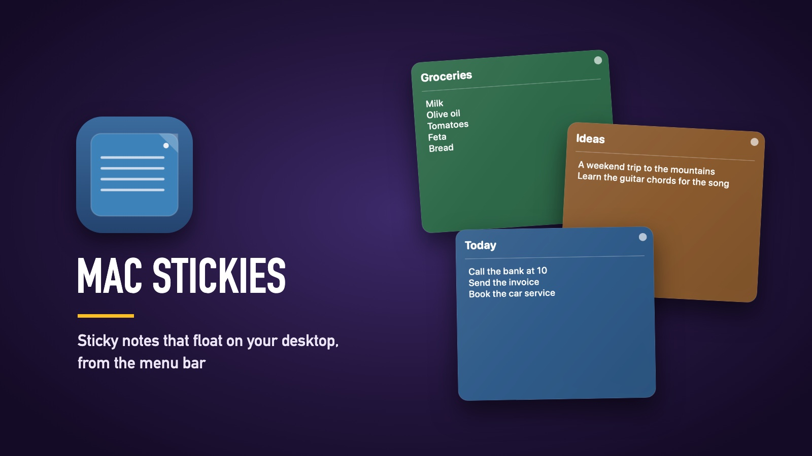

[← All software](https://github.com/gkaragioul/software)

# Mac Stickies



Sticky notes that float on your Mac's desktop, run from a small icon in the menu bar.

| | |
|---|---|
| **Download** | [⬇️ Mac (.dmg)](https://github.com/gkaragioul/mac-stickies/releases/latest/download/Mac-Stickies-mac.dmg) |
| **Version** |  · [what's new](https://github.com/gkaragioul/mac-stickies/releases) |
| **Runs on** | Macs with macOS 13 Ventura or newer (Apple silicon or Intel) |
| **Price** | Free |
| **Licence** | MIT: free to use, change and share |

## What it does

- **As many notes as you like,** each with a title and text, saved as you type.
- **Six colours:** Ocean, Forest, Plum, Cherry, Slate and Amber.
- **Move and resize them** anywhere. They stay on every desktop Space.
- **Pin a note** to keep it on top of other windows.
- **Hide and show** one note or all of them from the menu bar.
- **Back up and restore:** export all your notes to a file, and import them again.
- **Keyboard:** ⌘N makes a new note.

## Install

1. **Download** the file above.
2. **Open** it, and **drag Mac Stickies onto the Applications folder**.
3. **Double-click Mac Stickies** in Applications. macOS says it was **"Not Opened"**. This is normal for apps that aren't sold through Apple. Click **Done**.
4. **Allow it once:** open **Apple menu › System Settings › Privacy & Security**, scroll down to **Security**, and next to "Mac Stickies was blocked" click **Open Anyway**, then **Open Anyway** again.

It has no Dock icon: look for the note icon in the menu bar, at the top right of the screen.

## How to use it

1. Click the note icon in the menu bar and choose **New Sticky Note** (or press ⌘N).
2. Type a title and your note. It saves by itself.
3. Use the menu bar icon to change a note's colour, pin it, hide it or delete it, and to back up your notes with **Export Backup** and **Import Backup**.

## Privacy

- Your notes stay on your Mac, in `~/Library/Application Support/StickyNotesApp/notes.json`.
- Nothing is sent anywhere. There are no accounts, no tracking and no update checks.

## If something goes wrong

- **"Saved notes could not be read":** the notes file was damaged. Mac Stickies keeps a copy of the damaged file next to it, so you can try to recover it. Import a backup if you have one.
- **To report a problem:** [open an issue](https://github.com/gkaragioul/mac-stickies/issues).
- **To uninstall:** quit it from the menu bar, drag it to the Bin, and delete the `StickyNotesApp` folder above if you don't want to keep your notes.

Mac Stickies is finished: it does what it does, and no big new features are planned.

## Build it yourself

With Xcode or the Command Line Tools (Swift 5.9 or newer):

```bash
./build-mac.sh
```

It builds a universal app (Apple silicon and Intel) and the DMG in `dist-mac/`. Run the tests with `swift test`.

## Licence and credits

- **Licence:** Mac Stickies is MIT licensed (see [LICENSE](LICENSE)). You can use, change and share it freely, as long as you keep the copyright notice.
- It uses only Apple's own frameworks.

*Not affiliated with Apple. Made by [George Karangioules](https://github.com/gkaragioul).*
